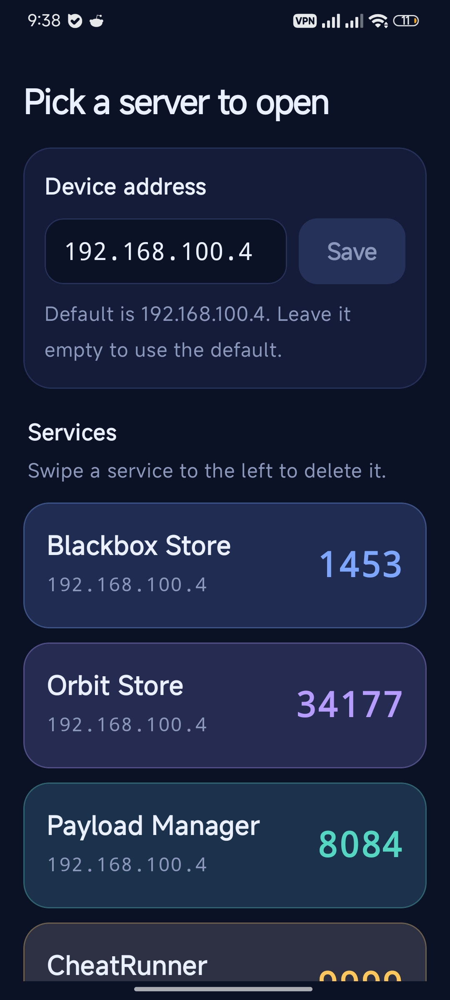

<p align="center">
  
</p>

<h1 align="center">PortConnect</h1>

<p align="center">
  A small Android launcher for the web pages running on devices in your local network.<br>
  Pick a service and it opens right inside the app.
</p>

<p align="center">
  <a href="https://github.com/zilyzal/PortConnect/releases/latest/download/PortConnect.apk"><b>Download PortConnect.apk</b></a>
</p>

<p align="center">
  <a href="https://github.com/zilyzal/PortConnect/releases/latest"></a>
  
  
</p>

<p align="center">
  
</p>

## What it does

- Shows your services as large tiles, each with its port number.
- Opens a service at `http://<device address>:<port>` in an in-app web view, with back and reload buttons. If the page can't be reached, it shows the address it tried and a **Try again** button.
- Remembers your device address. Type it into the **Device address** box and tap **Save**. The default is `192.168.100.4`. Leave the box empty to use the default.
- Lets you add your own services and delete any of them, including the defaults.
- Keeps your list and device address on the phone between launches.

## Using the app

| To do this | Do this |
| --- | --- |
| Open a service | Tap its tile |
| Change the device address | Type it in **Device address** and tap **Save** |
| Go back to the default address | Clear the box and tap **Save** |
| Add a service | Enter a name and a port in **Add a service** (at the bottom of the list), then tap **Add** |
| Delete a service | Swipe its tile to the left, far enough to turn the tile red |
| Get the original list back | Delete everything, then tap **Restore defaults** |

## Default services

| Name | Port |
| --- | --- |
| Blackbox Store | 1453 |
| Orbit Store | 34177 |
| Payload Manager | 8084 |
| CheatRunner | 9999 |
| Ps5upload | 9120 |

## Install

1. On your phone, download [PortConnect.apk](https://github.com/zilyzal/PortConnect/releases/latest/download/PortConnect.apk).
2. Open the file. When Android asks, allow installs from your browser or file manager.
3. Make sure your phone is on the same Wi-Fi network as the device you want to reach.

Releases are signed with a debug key, so Android won't install a new version over an older one. Uninstall the old version first. Your saved list is removed with it.

## Build it yourself

Open the project in Android Studio and run it, or push to GitHub. The **Build APK** workflow builds the app on every push to `main` and publishes `PortConnect.apk` as a release named after the version in `app/build.gradle.kts`.

```
app/src/main/java/com/example/portconnect/
  MainActivity.kt   app entry point and screen switching
  HomeScreen.kt     address box, service tiles, swipe to delete, add box
  WebScreen.kt      the in-app web view
  Services.kt       service model, default list, saving
  Theme.kt          colours and theme
```

- Kotlin 2.0.20 and Jetpack Compose (Material 3)
- Android Gradle Plugin 8.5.2
- minSdk 26, targetSdk 35

## Notes

- Pages are loaded over plain `http://`, because services on a local network don't normally have certificates.
- The app only reaches devices your phone can already reach. It does no scanning and sends nothing anywhere else.
